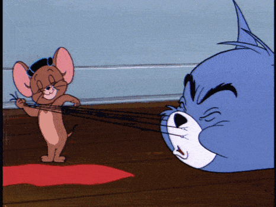
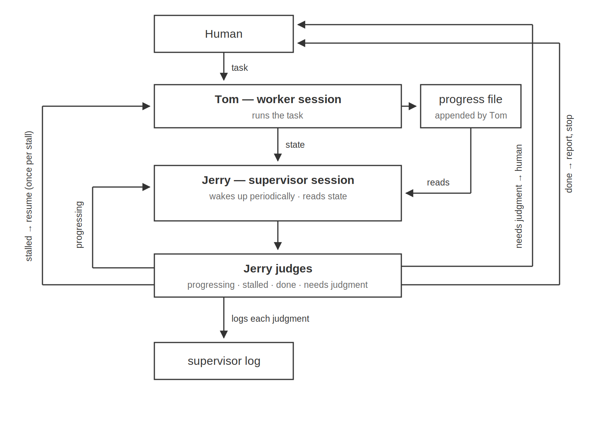

# tj-loop

A mechanism for keeping coding agents going: one supervisor watches one or more workers and resumes a worker when it stalls.

- **Tom** is the worker: a coding-agent session running a long task.
- **Jerry** is the supervisor: a second session that wakes up on a heartbeat, reads Tom's state, and judges whether Tom is progressing or stalled. When Tom stalls, Jerry sends a resume instruction. When Tom is done, Jerry reports and stops.

## How this differs from the Ralph loop

In the Ralph loop, the outer script repeats the same prompt to a fresh session and makes no judgment. The goal is fixed.

Here the judgment sits **outside the running session**. Jerry watches the *same* session and decides: progressing, stalled, done, or in trouble. Then he acts on it — resume Tom, leave him alone, or hand the problem to the human. Tom keeps his context. Jerry needs no memory of his own, because the state lives in files.

## Minimal requirements

1. A session is running a task on its own.
2. A supervisor runs periodically. The mechanism is free: `/loop` inside Claude Code, or cron outside it.
3. The supervisor can see the running session's state and output.
4. The supervisor can act on the running session: it can deliver an instruction the session will pick up.

Everything else (goal files, reports, dashboards, scoring gates) is an implementation detail of a particular setup.

## For agents

The instructions a supervisor session follows live in the tj-loop skill: [tj-loop/SKILL.md](tj-loop/SKILL.md) holds the common rules, and the per-environment adapters sit beside it in the same directory. To install, copy the `tj-loop` directory into your skills directory (for Claude Code, `~/.claude/skills/`).

## References

- [codex-whip](https://github.com/agticorp/codex-whip) by agticorp — the closest prior work we found in a survey on 2026-11-19: a manager LLM, woken periodically, reads a Codex session's state via tmux and injects continuations.
- [Ralph loop](https://ghuntley.com/ralph/) by Geoffrey Huntley — the starting point this pattern builds on.
